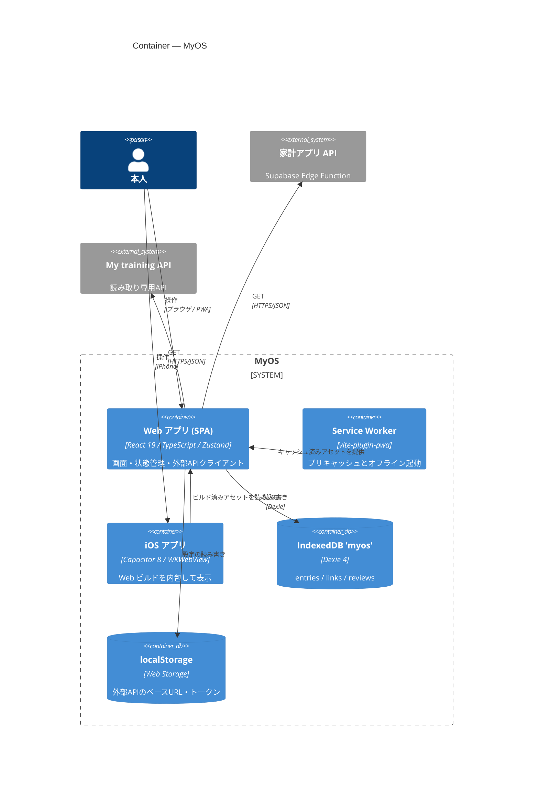

# MyOS

自分を理解するための、人生のOS。

## アーキテクチャ概要

サーバーを持たないローカルファーストの PWA（+ Capacitor による iOS ラッパー）。データは端末内 IndexedDB のみに保存し、外部の家計アプリ API / My training API は読み取り専用で参照する。



詳細（System Context / Component 図・データフロー・ディレクトリ構成）は [docs/architecture.md](docs/architecture.md) を参照。

---

## ドキュメント

- 要件定義書: [requirements.md](requirements.md)
- 設計ドキュメント索引: [docs/README.md](docs/README.md)
- 開発ルール: [CLAUDE.md](CLAUDE.md)

## 開発

```sh
npm install
npm run dev     # 開発サーバー
npm run build   # 型チェック + ビルド（dist/）
npm test        # Vitest
```
