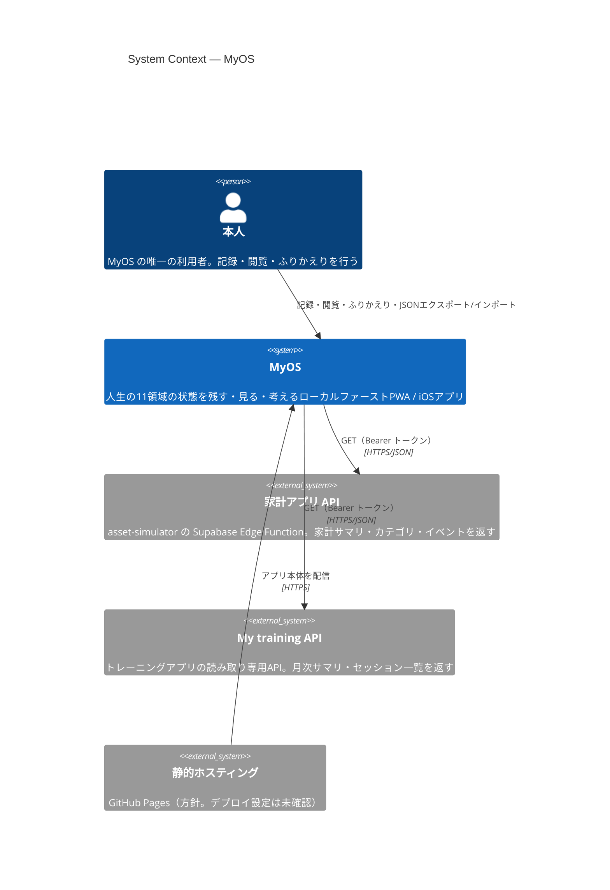
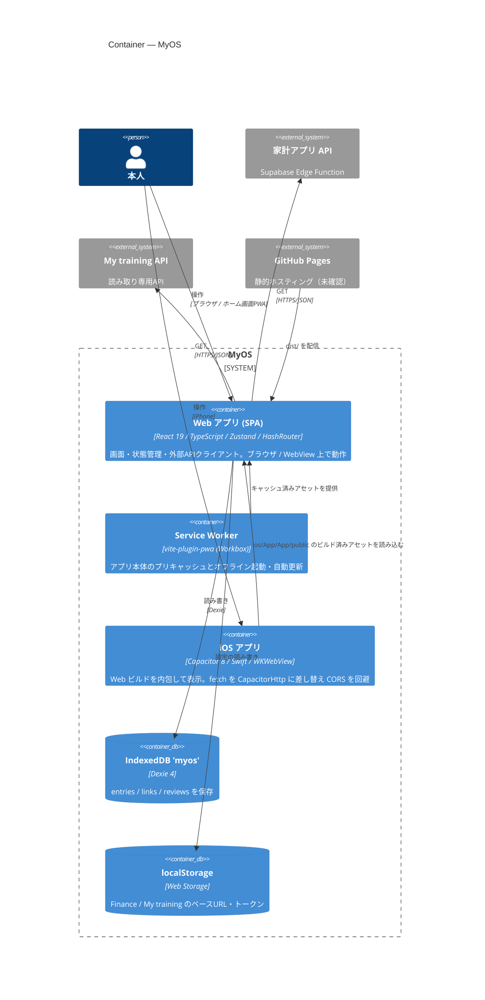
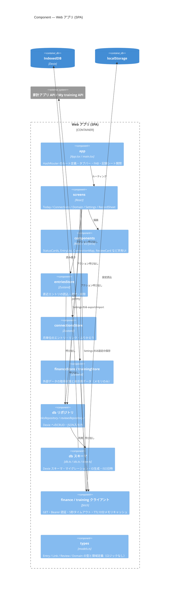
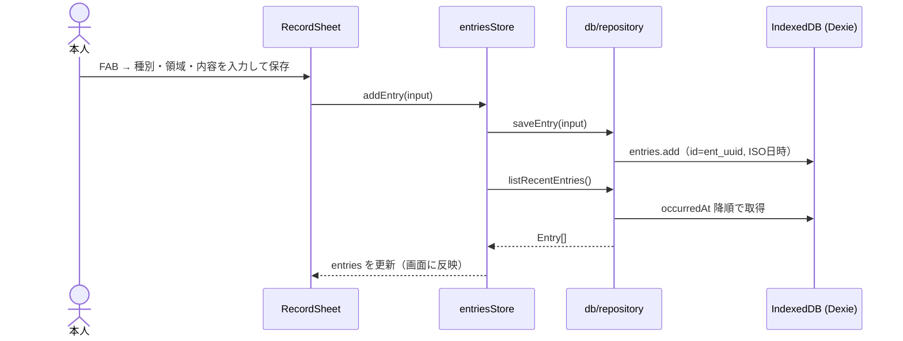
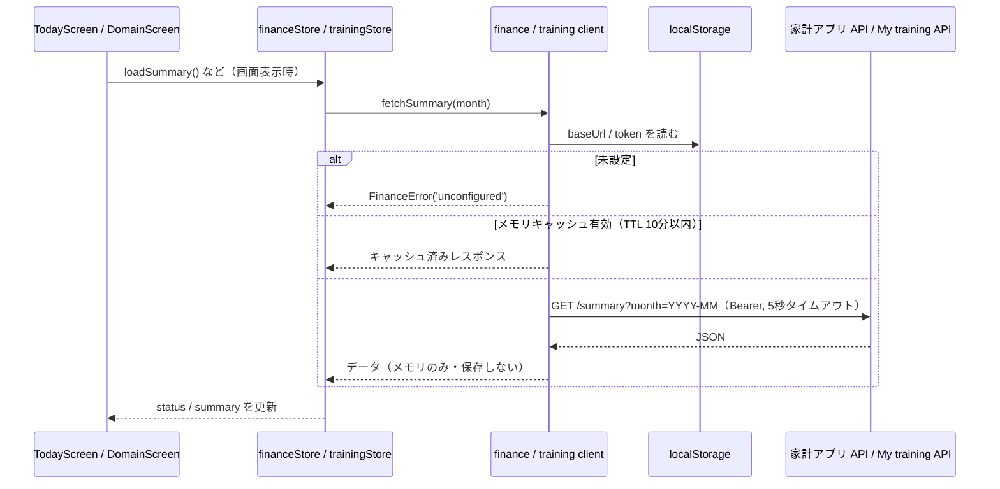
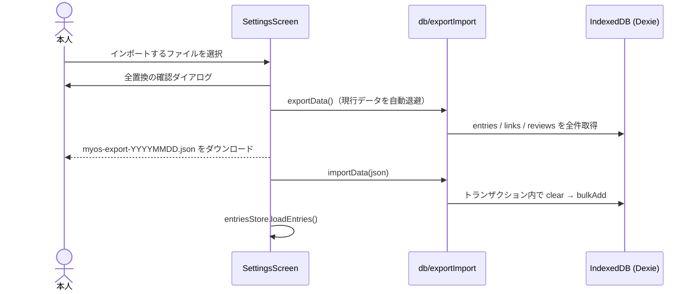

# アーキテクチャ（C4モデル）

MyOS の構成を [C4モデル](https://c4model.com/) の Level 1〜3 で図示する。
記述はリポジトリ内のコード・設定ファイルに基づく。コードから確認できない点は **未確認** と明記する。
設計方針・選定理由は [architecture/overview.md](architecture/overview.md) を参照。

## 1. 概要

| 項目 | 内容 |
|------|------|
| 目的 | 11の領域（Health / Mental / Career / Finance / Learning / Family / Social / Hobby / Travel / Private / Living）の状態を「残す・見る・考える」ための個人用アプリ。「管理」ではなく「理解」を目的とする（[requirements.md](../requirements.md)） |
| 利用者 | 開発者本人ひとり（マルチユーザー・認証・同期なし） |
| 形態 | サーバーを持たないローカルファーストの SPA / PWA。同じ Web ビルドを Capacitor で包んだ iOS アプリも `ios/` にある |
| データ保存先 | 端末内 IndexedDB（Dexie）のみ。外部連携の設定値（ベースURL・トークン）は localStorage |
| 外部接続 | 家計アプリ API（asset-simulator の Supabase Edge Function）と My training API への **GET のみ**。取得データは保存せずメモリ内キャッシュ（TTL 10分） |

### 技術スタック

`package.json` / 設定ファイルから確認できたもの。

| レイヤ | 技術 | 根拠 |
|--------|------|------|
| 言語 | TypeScript ~5.8 | `package.json`, `tsconfig*.json` |
| UI | React 19 / react-dom 19 | `package.json`, `src/app/main.tsx` |
| ルーティング | react-router-dom 7（`HashRouter`） | `src/app/App.tsx` |
| 状態管理 | Zustand 5 | `src/stores/*.ts` |
| ローカルDB | Dexie 4（IndexedDB） | `src/db/db.ts` |
| グラフ描画（つながりマップ） | d3-force + SVG | `src/components/ConnectionMap.tsx` |
| ビルド | Vite 6（`base: './'`） | `vite.config.ts` |
| PWA | vite-plugin-pwa（`registerType: 'autoUpdate'`） | `vite.config.ts` |
| iOS ラッパー | Capacitor 8（`@capacitor/ios`, SPM, CapacitorHttp 有効） | `capacitor.config.ts`, `ios/App/CapApp-SPM/Package.swift` |
| テスト | Vitest 3 + fake-indexeddb | `package.json`, `vite.config.ts`, `src/test/setup.ts` |

**未確認 / リポジトリに存在しないもの**

- CI・デプロイ設定（`.github/workflows/` が存在しない）。GitHub Pages で配信する方針は [architecture/overview.md](architecture/overview.md) に記載があるが、デプロイ手順はコードから確認できない
- `public/`（アイコン等）は存在しない。PWA manifest の `icons` は空配列
- ESLint / Prettier / Testing Library は依存に含まれていない
- Docker・IaC・サーバーサイドコードはない
- My training API の実装（MyOS 側はクライアント契約のみを持つ）

## 2. Level 1: System Context 図



| 名前 | 種別 | 技術 | 責務 |
|------|------|------|------|
| 本人 | Person | — | 唯一の利用者。エントリを記録し、きょう画面・つながり画面で状態を眺める |
| MyOS | Software System | React / Vite / Dexie / Capacitor | 記録の保存（端末内）、閲覧、つながり・月次ふりかえり、外部データの読み取り表示 |
| 家計アプリ API | External System | Supabase Edge Function（`src/finance/client.ts` のコメントより） | `/summary` `/categories` `/events` を GET で提供。MyOS は保存しない |
| My training API | External System | 未確認（My training 側で実装） | `/summary` `/sessions` を GET で提供。MyOS は保存しない |
| 静的ホスティング | External System | GitHub Pages（方針） | ビルド済み静的ファイルの配信。デプロイ設定は未確認 |

## 3. Level 2: Container 図



| 名前 | 種別 | 技術 | 責務 |
|------|------|------|------|
| Web アプリ (SPA) | Container | React 19 / TS / Zustand / react-router-dom（HashRouter） | 全画面と業務ロジック。`index.html` → `src/app/main.tsx` がエントリ |
| Service Worker | Container | vite-plugin-pwa | ビルド時に生成。プリキャッシュでオフライン動作、`autoUpdate` で更新 |
| iOS アプリ | Container | Capacitor 8（SPM）/ `AppDelegate.swift` | `webDir: 'dist'` を WebView で表示。Xcode の Run Script が `npm run build` → `npx cap copy ios` を自動実行 |
| IndexedDB 'myos' | Database | Dexie 4（schema v2） | `entries` / `links` / `reviews` の3テーブル。v2 で `projects` 領域を `career` に移行 |
| localStorage | Storage | Web Storage | `myos.finance.*` / `myos.training.*`。エクスポートJSONには含めない |
| 家計アプリ API | External | Supabase Edge Function | 金銭データの提供元（読み取りのみ） |
| My training API | External | 未確認 | トレーニングデータの提供元（読み取りのみ） |
| GitHub Pages | External | 静的ホスティング | `dist/` の配信（デプロイ設定は未確認） |

> バックエンド・バッチ・サーバーDB・認証基盤は存在しない。

## 4. Level 3: Component 図 — Web アプリ (SPA)



| 名前 | 種別 | 技術 | 責務 |
|------|------|------|------|
| app | Component | `src/app/App.tsx`, `main.tsx` | ルート `/` `/connections` `/domain/:domain` `/settings` の定義、`AppTabBar`・`Fab`・`RecordSheet` の配置、CSS 読込 |
| screens | Component | `src/screens/*.tsx` | `TodayScreen`（状態カード・タイムライン）、`ConnectionsScreen`（マップ・月次ふりかえり）、`DomainScreen`（領域別一覧 + Finance/Health の外部データ）、`SettingsScreen`（API設定・JSON入出力）、`RecordSheet`（エントリ4種の入力） |
| components | Component | `src/components/*.tsx` | `StatusCards` `EntryList` `ConnectionMap`（d3-force） `ReviewCard` `MonthSwitcher` `DomainChip` `AppTabBar` `Fab` |
| entriesStore | Component | `src/stores/entriesStore.ts` | `loadEntries` / `addEntry` / `removeEntry`。変更後は entries のみ再読込 |
| connectionsStore | Component | `src/stores/connectionsStore.ts` | `loadMonth` / `addLink` / `removeLink` / `saveReview` |
| financeStore / trainingStore | Component | `src/stores/financeStore.ts`, `trainingStore.ts` | 取得状態（`idle/loading/ok/unconfigured/unauthorized/error`）と表示データの保持。永続化しない |
| db リポジトリ | Component | `src/db/repository.ts` ほか | エントリ・リンク・ふりかえりの CRUD、`exportData` / `importData`（全置換） |
| db スキーマ | Component | `src/db/db.ts`, `ids.ts`, `time.ts` | Dexie スキーマ（v1→v2 マイグレーション）、`ent_` / `lnk_` / `rev_` + UUID の ID、ISO 8601 日時 |
| finance / training クライアント | Component | `src/finance/client.ts`, `src/training/client.ts` | 読み取り専用 API 呼び出しとエラー分類、localStorage の設定管理 |
| types | Component | `src/types/models.ts` | 型と定数（`DOMAINS`, `DOMAIN_LABELS`）のみ |

**依存の方向**: 画面 → ストア → リポジトリ → Dexie の一方向（CLAUDE.md の規約）。例外として `SettingsScreen` は `db/exportImport` と各クライアントの設定関数を直接呼ぶ（コードで確認）。

## 5. 主要なデータフロー

### 5.1 エントリを記録する（残す）



### 5.2 外部データを表示する（読み取り専用ポーリング）



### 5.3 バックアップ（JSON エクスポート / インポート）



## 6. ディレクトリ構成

```
my-os/
├── index.html              # Vite エントリ（/src/app/main.tsx を読み込む）
├── vite.config.ts          # Vite・PWA（manifest）・Vitest 設定
├── capacitor.config.ts     # Capacitor 設定（appId, webDir=dist, CapacitorHttp）
├── package.json            # 依存・scripts（dev / build / preview / test）
├── tsconfig*.json          # TypeScript 設定
├── requirements.md         # 要件定義書
├── CLAUDE.md               # 開発ルール
├── MyOS_ConceptSheet.pdf   # コンセプトシート
├── MyOS_UIMockUp.pdf       # UIモックアップ
├── doc-page.js / support.js / ios-frame.jsx
│                           # デザイン用スキャフォールド（ビルド・アプリからは参照されない）
├── docs/                   # 設計ドキュメント
├── ios/                    # Capacitor iOS プロジェクト（Xcode / SPM）
│   └── App/
│       ├── App/            # AppDelegate.swift・Info.plist・アセット（public/ は gitignore）
│       ├── App.xcodeproj/  # Run Script「Build Web Assets」を含む
│       └── CapApp-SPM/     # Capacitor の SPM パッケージ定義
├── .claude/skills/         # Claude Code 用スキル（UIスタイルガイド）
└── src/
    ├── app/                # エントリポイント・ルーティング
    ├── screens/            # 画面（Today / Connections / Domain / Settings / RecordSheet）
    ├── components/         # 共有UI
    ├── stores/             # Zustand ストア（+ テスト）
    ├── db/                 # Dexie スキーマ・リポジトリ・ID・日時・入出力（+ テスト）
    ├── finance/            # 家計アプリAPIクライアント（GET のみ）
    ├── training/           # My training APIクライアント（GET のみ）
    ├── styles/             # tokens.css（デザイントークン）・base.css
    ├── types/              # 型定義のみ
    └── test/               # Vitest セットアップ（fake-indexeddb）
```

| ディレクトリ | 役割 |
|-------------|------|
| `src/app` | `createRoot` での起動、`HashRouter` によるルーティング（GitHub Pages のサブパス配信向け） |
| `src/screens` | ルート単位の画面とボトムシート |
| `src/components` | 画面から使う表示部品。つながりマップは d3-force で配置し SVG 描画 |
| `src/stores` | 画面とデータ層の仲介。DB アクセスは必ずここを経由 |
| `src/db` | IndexedDB の唯一の窓口。スキーマ・マイグレーション・CRUD・エクスポート |
| `src/finance` / `src/training` | 外部 API の読み取り専用クライアント。データは保存しない |
| `src/styles` | CSS 変数によるデザイントークンとベーススタイル |
| `src/types` | ドメイン型と定数（ロジックを置かない） |
| `ios` | Capacitor による iOS ネイティブラッパー |
| `docs` | 機能・UI・DB・アーキテクチャの設計書（索引: [README.md](README.md)） |
